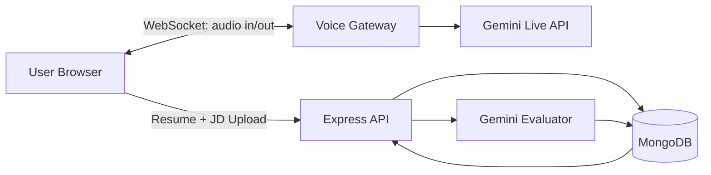

# PrepMate AI — Full-Stack Scaffold

A starter codebase for the PrepMate AI voice interview simulator. This is scaffolded to be dropped into your own dev environment and extended.

## Stack

- **Frontend**: React + Vite + TypeScript + Tailwind CSS
- **Backend**: Node.js + Express + TypeScript
- **AI voice**: Google Gemini Live API (via `@google/genai`) — with a fallback to browser Web Speech API if Live is unavailable
- **Evaluation LLM**: Gemini `gemini-3.5-flash-lite` by default for interview questions, job description analysis, and post-interview scoring
- **Database**: MongoDB via Mongoose
- **Realtime**: WebSocket (`ws`) between frontend and backend for audio streaming

## Architecture



## Getting started

```bash
# 1. Install dependencies (frontend + backend)
cd backend && npm install
cd ../frontend && npm install

# 2. Configure environment
cp backend/.env.example backend/.env
# Fill in GEMINI_API_KEY and MONGODB_URI

# 3. Start MongoDB (locally or Atlas)
# Then start the backend
cd backend && npm run dev

# 4. In another terminal, start the frontend
cd frontend && npm run dev
```

Backend runs on `http://localhost:8080`, frontend on `http://localhost:5173`.

## Directory layout

```
scaffold/
├── frontend/          # Vite + React + TS
│   ├── src/
│   │   ├── components/
│   │   ├── pages/
│   │   ├── hooks/
│   │   ├── services/    ← API client + voice provider
│   │   └── types/
│   └── ...
├── backend/           # Express + TS
│   ├── src/
│   │   ├── controllers/
│   │   ├── routes/
│   │   ├── models/       ← Mongoose schemas
│   │   ├── services/
│   │   │   ├── ai/       ← Evaluation LLM
│   │   │   └── voice/    ← Gemini Live gateway (swappable)
│   │   ├── middleware/
│   │   └── config/
│   └── ...
└── README.md
```

## API surface

| Method | Route | Purpose |
|---|---|---|
| POST | `/api/resume/upload` | Upload PDF/DOCX; returns parsed resume |
| POST | `/api/job-description/analyze` | Extract skills & role from JD text |
| POST | `/api/interviews` | Create an interview session |
| GET  | `/api/interviews` | List sessions |
| GET  | `/api/interviews/:id` | Get one session (transcript included) |
| POST | `/api/interviews/:id/end` | Mark ended; triggers async evaluation |
| GET  | `/api/interviews/:id/report` | Fetch generated report |
| GET  | `/api/dashboard` | Stats + recent sessions |
| WS   | `/ws/voice?sessionId=…` | Bidirectional audio stream |

Auth is JWT-based; see `backend/src/middleware/auth.ts`.

## Environment variables

See `backend/.env.example`. Never expose `GEMINI_API_KEY` to the browser — all Gemini calls go through the backend.

## Voice provider abstraction

`backend/src/services/voice/` contains a `VoiceProvider` interface with two implementations:

- `GeminiLiveProvider` — production, uses `@google/genai` Live API for real-time audio
- `WebSpeechProvider` (stub) — falls back to browser STT/TTS + text-only LLM

Swap providers by setting `VOICE_PROVIDER=gemini-live | web-speech` in `.env`.

## Deployment

- Frontend: Vercel / Netlify (`npm run build` → static bundle)
- Backend: Railway / Render / Fly.io (`npm run start` after `npm run build`)
- DB: MongoDB Atlas

## What still needs your work

This scaffold is intentionally lean. To fully implement:

1. Wire Gemini Live audio streaming in `backend/src/services/voice/gemini-live.ts`
2. Implement the actual PDF/DOCX parsing in `backend/src/services/resume-parser.ts` (use `pdf-parse` and `mammoth`)
3. Add rate limiting and production-grade logging

## Authentication and user data

- Create accounts at `/signup` and sign in at `/login`.
- Set a unique, private `JWT_SECRET` and provide `MONGODB_URI` and `GEMINI_API_KEY` in `backend/.env`.
- Resume, job description, and interview records are attached to the authenticated MongoDB user ID. Interview routes, dashboard queries, reports, and the voice WebSocket verify that ownership.
- The default `web-speech` voice provider uses browser speech recognition and synthesis, with Gemini generating interviewer questions and evaluations. `gemini-live` remains a separate provider option.

## License

MIT. Use freely for your presentation and beyond.
